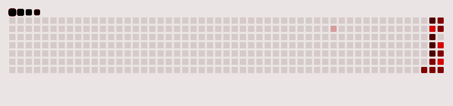

<a href="https://git.io/typing-svg">
  
</a>

### Skills

<p>
  
</p>
<p>
  <sub>
    <b>Systems:</b> C · C++ · Python · Go · Bash<br>
    <b>Web &amp; ERP:</b> TypeScript · Next.js · React · NestJS · Tailwind · Frappe · ERPNext<br>
    <b>Data &amp; Infra:</b> PostgreSQL · Drizzle · Prisma · Redis · Docker · Turborepo
  </sub>
</p>

### Development Environments


<p align="center">
<table align="center" width="100%">
<tr>
<td width="50%" align="center">
  
</td>
<td width="50%" align="center">
  
</td>
</tr>
</table>
</p>

### About me

* 🧙🏼‍♂️ currently building [`mibicc`](https://github.com/mi-vault/mibicc): a tiny C99 compiler targeting Linux and Windows x64 ABIs
* 🏗️ engineering custom **ERPNext & Frappe** systems and **Next.js, NestJS & PostgreSQL** platforms
* 🧠 interests: systems programming, compilers, database internals

<p>
  <a href="mailto:asmisharma2026@gmail.com">
    
  </a>
</p>

<br>

<table>
<tr>
<td width="215px" align="center" valign="middle">
  
</td>
<td align="center" valign="middle">
  
</td>
</tr>
</table>

```ruby
⠀⠀⠀⠀⠀⠀⠀⠀⠀⠀⠀⠀⠀⠀⠀⠀⠀⠀⠀⠀⠀⠀⠀⠀⠀⠀⠀⠀⠀⠀⠀⠀⠀⠀⠀⠀⡄⠀⠀⠀⠀⠀⠀⠀⠀⠀⠀⠀⠀⠀⠀⠀⠀⠀⠀⠀⠀⠀⠀⠀⠀⠀⠀⠀⠀⠀⠀⠀⠀⠀⠀⠀
⠀⠀⠀⠀⠀⠀⠀⠀⠀⠀⠀⠀⠀⠀⠀⠀⠀⠀⠀⠀⠀⠀⠀⠀⠀⠀⠀⠀⠀⠀⠀⠀⠀⠀⠀⠀⡇⠀⠀⠀⠈⠀⠀⠀⠀⠀⠀⠀⠀⠀⠀⠀⠀⠀⠀⠀⠀⠀⠀⠀⠀⠀⠀⠀⠀⠀⠀⠀⠀⠀⠀⠀
⠀⠀⠀⠀⠀⠀⠀⠀⠀⠀⠀⠀⠀⠀⠀⠀⠀⠀⠀⠀⠀⠀⠀⠀⠀⠀⠀⠀⠀⠀⠀⠀⠀⠀⠀⠀⡇⡀⠀⠀⠀⠀⠀⠀⠀⠀⠀⠀⠀⠀⠀⠀⠀⠀⠀⠀⠀⠀⠀⠀⠀⠀⠀⠀⠀⠀⠀⠀⠀⠀⠀⠀
⠀⠀⠀⠀⠀⠀⠀⠀⠀⠀⠀⠀⠀⠀⠀⠀⠀⠀⠀⠀⠀⠀⠀⠀⠀⠀⠀⠀⠀⠀⠀⠀⠀⠀⠄⢰⠇⠀⠀⠠⠀⠀⠀⠀⠀⠀⠀⠀⠀⠀⠠⠀⠀⠀⠀⠀⠀⠀⠀⠀⠀⠀⠀⠀⠀⠀⠀⠀⠀⠀⠀⠀
⠀⠀⠀⠀⠀⠀⠀⠀⠀⠀⠀⠀⠀⠀⠀⠀⠀⠀⠀⠀⠀⠀⠀⠀⠀⠀⠀⠀⠀⠀⠀⠀⠀⠀⠀⢸⢸⠀⠀⠂⠀⠀⠀⠀⠀⠀⠀⠀⠀⠀⠀⠀⠀⠀⠀⠀⠀⠀⠄⠀⠀⠀⠀⠀⠀⠀⠀⠀⠀⠀⠀⠀
⠀⠀⠀⠀⠀⠀⠀⠀⠀⠀⠀⠀⠀⠀⠀⠀⠀⠀⠀⠀⠀⠀⠀⠀⠀⠠⠀⠀⠀⠁⠀⠀⠀⠀⡇⢸⢸⡇⠇⢀⠀⠀⠀⠀⠀⠀⠀⠀⠀⠀⠀⠀⠀⠀⠀⠀⠀⠀⠀⠀⠀⠀⠀⠀⠀⠀⠀⠀⠀⠀⠀⠀
⠀⠀⠀⠀⠀⠀⠀⠀⠀⠀⠀⠀⠀⠀⠀⠀⠀⠀⠀⠀⠀⠀⠀⠀⠀⠀⠀⠀⠀⢀⠀⠀⠇⢀⡇⢸⣸⠀⠀⠀⠀⠀⠀⠀⠁⠀⠀⠀⠀⠀⠀⠀⠀⠀⠀⠀⠀⢀⠀⠀⠀⠀⠀⠀⠀⠀⠀⠀⠀⠀⠀⠀
⠀⠀⠀⠀⠀⠀⠀⠀⠈⠀⠀⠀⠀⠀⠀⠀⠀⠀⠀⠂⠀⠀⠀⠀⠀⠀⠀⠀⠀⢸⢀⠀⠃⢸⢠⢸⣿⢸⠀⠀⠀⠠⠀⠀⠀⠀⠀⠀⠀⠀⠀⠀⠁⠀⠀⠐⠀⠀⠀⠀⠀⠀⠀⠀⠀⠀⠀⠀⠀⠀⠀⠀
⠀⠀⠀⠀⠀⠀⠀⠀⠀⠀⠀⠀⠀⠀⡀⠰⠀⠀⠀⠀⠀⠀⠀⠀⠄⠀⠀⠀⠀⢸⢸⢠⠀⣾⢸⢸⣿⢸⢀⢠⠀⡆⡇⠀⠀⠐⠀⠀⠀⠀⠀⠀⠀⠀⠀⠀⠀⠀⠀⠀⠀⠀⠀⠀⠀⠀⠀⠀⠀⠀⠀⠀
⠀⠀⠀⠀⠀⠀⠀⠀⠀⠀⠀⠁⠀⠀⠀⠀⢃⠀⢀⠀⠀⠀⢀⠀⠀⠀⠀⠀⠁⠘⢸⢸⠀⡏⣿⢸⣿⢸⡘⢸⡀⡇⡇⡀⠀⠀⠀⠄⠀⠀⠀⠃⠀⠀⠀⠀⠀⠀⠀⠀⠀⠀⠀⠀⠀⠀⠀⠀⠀⠀⠀⠀
⠀⠀⠀⠀⠀⠀⠀⠀⠀⠀⠀⠀⠀⠀⠀⣀⠀⢄⠀⠀⢀⠀⠀⢢⡀⠀⠀⠀⢰⠀⣸⢸⢴⣇⡟⣾⣿⢸⣿⢸⡇⡇⡇⡇⠰⠀⠀⠀⠈⠀⠀⠀⠀⠀⠀⠁⠀⠀⠀⠀⠀⠀⠀⠀⠀⠀⠀⠀⠀⠀⠀⠀
⠀⠀⠀⠀⠀⠀⠀⠀⠀⠀⠀⢀⠀⠐⢄⠘⢄⠀⠣⡀⠀⠑⢄⠀⠱⣄⠁⡄⠆⣇⢿⢸⣾⣿⣇⣿⣿⣼⣿⣸⢷⡇⣼⢀⠀⠀⣠⠊⠀⣠⠆⠀⠀⠀⠁⠡⠎⠀⠈⠀⠀⠀⠀⠀⠀⠀⠀⠀⠀⠀⠀⠀
⠀⠀⠀⠀⠀⠀⠀⠈⠢⠀⠀⠀⡑⢄⠀⠁⠀⠑⢄⠙⢦⡀⠢⠙⡦⣈⢧⡻⣜⠼⣜⢯⣿⣿⣿⣿⣿⣿⣿⣿⣼⣹⢣⢣⢡⠞⣁⣴⠞⡁⠀⠀⠀⡠⠀⠀⠤⠀⠀⠀⠀⠀⡠⠀⠀⠀⠀⠀⠀⠀⠀⠀
⠀⠀⠀⠀⠀⠀⠀⠀⠀⠀⠑⠠⡈⠒⠥⣀⠀⠐⠄⡉⠢⣝⡲⢬⡪⣎⢧⠽⠟⡺⠿⠛⠋⠉⠉⠉⠉⠉⠙⠛⠛⠿⣟⡻⢷⣾⣫⠥⡺⠕⣀⠤⡊⠀⢠⠀⢀⡠⠂⢀⡠⠊⠀⠀⠀⠀⠀⠀⠀⠀⠀⠀
⠀⠀⠀⠀⢀⠀⠀⠀⠀⠀⠒⠤⣀⠑⠢⠬⣽⣒⠤⠈⠒⡦⢭⣟⠚⣩⠰⠊⠁⠀⠀⠀⢀⡀⡀⠀⠀⠀⠀⠀⠀⢀⠀⠉⠓⢮⣝⡳⢻⣭⠖⣋⠠⣀⡴⠞⡩⠄⠚⠁⠀⠀⠄⠀⠀⠀⠀⠀⠀⠀⠀⠀
⠀⠀⠀⠀⠈⠀⠀⢀⡀⠈⠀⠀⠀⠈⠁⠒⠀⠬⠍⠛⠛⣚⣩⡆⠋⠁⣀⣴⣶⠏⣠⡞⣡⣶⣶⣶⡄⠀⠀⠀⠀⠀⠻⣷⣦⣀⠈⠛⢶⣬⣓⣒⢛⣃⣉⠠⠔⠀⠠⠂⠁⠀⠀⠀⠠⠀⠀⠀⠀⠀⠀⠀
⠀⠀⠀⠀⠂⠠⠀⠀⠀⠈⠁⠐⠢⠤⣁⣒⣒⣛⣂⣶⡟⠟⠉⢀⣤⣾⣿⣿⡏⢠⢶⡃⢿⣿⣿⠿⠁⠀⠀⠀⠀⠀⠀⢹⣿⣿⣷⣤⠀⠈⠻⢯⣟⣂⣂⣒⣒⣒⣈⡩⠥⠐⠈⠁⠀⠀⠠⠀⠈⠉⠁⠀
⠀⠀⢀⠀⠀⠀⠀⠈⠉⠉⠉⠀⠐⠒⣒⣛⣿⣿⣛⠉⠀⠀⠠⣾⣿⣿⣿⣿⡅⢊⠎⣹⠀⠉⠁⠀⠀⠀⠀⠀⠀⠀⠀⢸⣿⣿⣿⣿⣷⠀⠀⠀⠉⣛⠒⢲⠆⠡⠤⠤⠤⠒⠒⠀⠈⠀⠀⠀⠀⠀⢀⡀
⢀⡀⠀⠀⠈⠀⡀⠠⠤⠐⠒⠒⣒⠒⠚⠳⠼⠛⠿⣶⣥⡠⡀⠙⢿⣿⣿⣿⣇⠀⠘⠄⠃⠀⠀⠀⠀⠀⠀⠀⠀⠀⠀⣮⣿⣿⣿⠟⠃⠀⢀⣴⣶⠿⠛⢿⣽⣛⠋⣉⣉⠉⠒⠒⠒⠂⠐⠀⠉⠀⠀⠀
⠀⠀⠀⠀⠀⠠⠀⠀⠒⠀⠩⠉⠀⠉⠉⢑⡚⢛⢋⠸⠝⠿⣮⣔⠄⡈⠛⠿⣿⣄⠈⠀⠁⠂⠄⠀⠀⠀⠀⠀⠀⢀⣼⣿⠿⠛⢁⢀⣠⣾⡻⠯⠭⣉⡙⠓⠚⠥⢄⡀⠀⠀⠈⠉⠐⠒⠀⠀⠀⠀⠀⠀
⠀⠀⠀⠀⢀⠀⠀⠤⠄⠀⠤⠐⠀⠈⢉⡠⠄⣀⠤⠒⣈⡭⠾⢙⡿⣾⣤⣂⠀⣉⠑⠀⠀⠀⠀⠀⠀⠀⠀⠀⠐⠊⣉⠠⣀⣬⡶⢿⣟⠯⢍⡛⠶⡤⠉⠑⠢⢄⠀⠀⠉⠀⠂⠠⠀⠀⠀⠀⠀⠀⠀⠀
⠀⠀⠀⠀⠀⠀⠀⠀⠀⠀⠀⢀⠀⠒⡡⠔⠈⠀⠢⠋⠁⠂⠀⣡⠴⢃⣵⢟⡟⣷⣾⣿⣶⣶⣤⣤⣤⣴⣶⣦⣬⡷⣶⢿⢯⡳⣌⠢⢍⠛⠦⠌⠑⠠⠀⠀⠲⠤⡉⠢⠀⠈⠀⡀⠀⠀⠀⠀⠀⠀⠀⠀
⠀⠀⠀⠀⠀⠀⠠⠀⠀⠀⠀⠀⠀⠊⠀⠀⠀⠀⠄⠀⠀⠁⠘⢁⢀⠔⠁⠁⣽⢣⣇⡏⡏⣿⡟⣿⣿⢿⣿⣿⢸⡵⢹⣯⠆⠑⢜⢣⡀⠉⠢⣈⠂⠀⠀⠀⠀⠀⠀⠂⡀⠀⠀⠀⠑⢄⠀⠀⠀⠀⠀⠀
⠀⠀⠀⠀⠀⠀⠀⠀⠀⠀⠀⠂⠀⠀⠀⠀⠀⠀⠀⠔⠀⠀⡠⠈⠀⠀⠀⣰⠑⢸⣹⢹⢿⣿⡇⣿⣿⢸⡟⢸⠈⣷⠁⠙⢇⠀⠀⠀⠙⢦⡀⠈⠃⢄⠀⠀⠀⠐⠀⠀⠀⠀⠀⠄⠀⠀⠀⠀⠀⠀⠀⠀
⠀⠀⠀⠀⠀⠀⠀⠀⠀⠀⠀⠀⠀⠀⠀⠐⠀⡀⠁⠀⠀⠀⠀⠀⠀⠀⠁⠃⠇⢸⢸⢸⠸⡏⡇⢸⣿⢸⣧⢨⠀⡝⡏⠀⠈⠂⠀⠀⠀⢀⠀⠀⠀⡀⠑⡀⠀⠀⠀⠈⠀⠀⠀⠀⠀⠀⠀⠀⠀⠀⠀⠀
⠀⠀⠀⠀⠀⠀⠀⠀⠀⠀⠀⠀⠀⠀⠀⠀⠀⠀⠀⠀⠀⠀⠒⠀⠀⠀⠀⠀⠀⡸⢸⢸⠀⣧⢿⢸⣿⠀⣿⠈⠀⠇⡇⠀⠀⠀⠐⠀⠀⠀⠀⠀⠀⠀⠀⠈⠄⠀⠀⠀⠄⠀⠀⠀⠀⠀⠀⠀⠀⠀⠀⠀
⠀⠀⠀⠀⠀⠀⠀⠀⠀⠀⠀⠀⠀⠀⠀⠀⠀⠀⠀⠀⠀⠀⠀⠀⠀⠈⠀⢀⠀⢁⠘⠀⡀⠸⡌⢸⣿⠀⡏⠀⢀⠀⡄⠀⣤⠀⠀⠀⠐⠀⠀⠀⠀⠀⢠⠀⠀⠀⠀⠀⠀⠀⠀⠀⠀⠀⠀⠀⠀⠀⠀⠀
⠀⠀⠀⠀⠀⠀⠀⠀⠀⠀⠀⠀⠀⠀⠀⠀⠀⠀⠐⠀⠀⠀⠀⠀⠀⠀⠀⠀⠀⢸⠀⡀⠇⠸⠃⢸⣿⠀⠇⠀⠀⢰⠀⠀⠀⠀⠀⠀⠀⠈⠀⠂⠀⠀⠀⠀⠀⠀⠀⠀⠀⠀⠀⠀⠀⠀⠀⠀⠀⠀⠀⠀
⠀⠀⠀⠀⠀⠀⠀⠀⠀⠀⠀⠀⠀⠀⠀⠀⠀⠀⠀⠀⠀⠀⠀⠀⠀⠀⡀⠀⢀⠀⠀⠀⠁⠀⠂⠸⡟⠀⠀⠀⠀⠂⠀⠀⠀⠀⠀⠀⠀⠀⠀⠀⠀⠀⠀⠀⠀⠠⠀⠀⠀⠀⠀⠀⠀⠀⠀⠀⠀⠀⠀⠀
⠀⠀⠀⠀⠀⠀⠀⠀⠀⠀⠀⠀⠁⠀⠀⠀⠀⠀⠀⠀⠀⠀⠀⠀⠀⠀⠁⠀⠀⠀⠀⠀⠂⠀⠀⠀⡇⠀⠀⠀⠀⠀⠀⠀⠀⠀⠀⠀⡀⠀⠀⠀⠀⠀⠀⠀⠀⠀⠀⠀⠀⠀⠀⠀⠀⠀⠀⠀⠀⠀⠀⠀
⠀⠀⠀⠀⠀⠀⠀⠀⠀⠀⠀⠀⠀⠀⠀⠀⠀⠀⠀⠀⠀⠀⠀⠀⠄⠀⠀⠀⠀⠀⠀⠀⠀⠀⠀⠀⡇⠤⠀⠀⠀⠀⠀⠀⠀⠀⠀⠀⠀⠀⠀⠀⠀⠀⠀⠀⠀⠀⠀⠀⠀⠀⠀⠀⠀⠀⠀⠀⠀⠀⠀⠀
⠀⠀⠀⠀⠀⠀⠀⠀⠀⠀⠀⠀⠀⠀⠀⠀⠀⠀⠀⠀⠀⠀⠀⠀⠀⠀⠀⠀⠀⠀⠀⠀⠀⠀⠀⠀⡇⠀⠀⠀⠀⠀⠈⠁⠀⠀⠀⠀⠀⠀⠀⠀⠀⠀⠀⠀⠀⠀⠀⠀⠀⠀⠀⠀⠀⠀⠀⠀⠀⠀⠀⠀
⠀⠀⠀⠀⠀⠀⠀⠀⠀⠀⠀⠀⠀⠀⠀⠀⠀⠀⠀⠀⠀⠀⠀⠀⠀⠀⠀⠀⠀⠀⠀⠀⠀⠀⠀⢰⠀⠀⠀⠀⠀⠀⠀⠀⠀⠀⠀⠀⠀⠀⠀⠀⠀⠀⠀⠀⠀⠀⠀⠀⠀⠀⠀⠀⠀⠀⠀⠀⠀⠀⠀⠀
```
