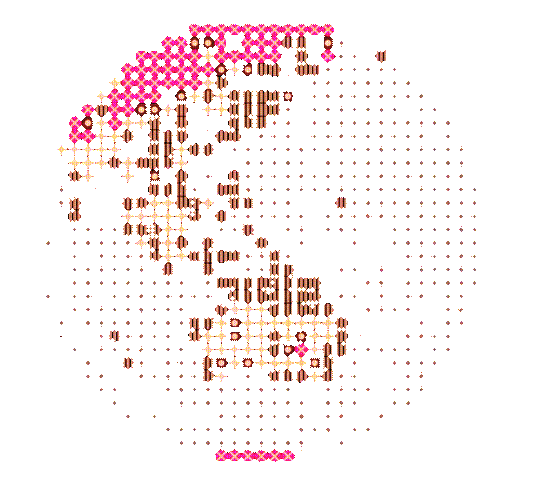
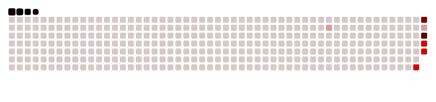

<a href="https://git.io/typing-svg">
  
</a>

<p>
   <strong>Skills</strong>
</p>

[](https://skillicons.dev)

### Development Environments:


<p align="center">
<table align="center">
<tr>
<td width="50%" align="center">
  
</td>
<td width="50%" align="center">
  
</td>
</tr>
</table>
</p>

### About me

- 🧙🏼‍♂️ currently building [`mibicc`](https://github.com/mi-vault/mibicc) - a tiny C99 compiler, written in C
- systems programming, compilers, database internals

<br>

<table>
<tr>
<td width="170px" align="center" valign="middle">
  
</td>
<td align="center" valign="middle">
  
</td>
</tr>
</table>

```ruby
⠀⠀⠀⠀⠀⠀⠀⠀⠀⠀⠀⠀⠀⠀⠀⠀⠀⠀⠀⠀⠀⠀⠀⠀⠀⠀⠀⠀⠀⠀⠀⠀⠀⠀⠀⠀⡄⠀⠀⠀⠀⠀⠀⠀⠀⠀⠀⠀⠀⠀⠀⠀⠀⠀⠀⠀⠀⠀⠀⠀⠀⠀⠀⠀⠀⠀⠀⠀⠀⠀⠀⠀
⠀⠀⠀⠀⠀⠀⠀⠀⠀⠀⠀⠀⠀⠀⠀⠀⠀⠀⠀⠀⠀⠀⠀⠀⠀⠀⠀⠀⠀⠀⠀⠀⠀⠀⠀⠀⡇⠀⠀⠀⠈⠀⠀⠀⠀⠀⠀⠀⠀⠀⠀⠀⠀⠀⠀⠀⠀⠀⠀⠀⠀⠀⠀⠀⠀⠀⠀⠀⠀⠀⠀⠀
⠀⠀⠀⠀⠀⠀⠀⠀⠀⠀⠀⠀⠀⠀⠀⠀⠀⠀⠀⠀⠀⠀⠀⠀⠀⠀⠀⠀⠀⠀⠀⠀⠀⠀⠀⠀⡇⡀⠀⠀⠀⠀⠀⠀⠀⠀⠀⠀⠀⠀⠀⠀⠀⠀⠀⠀⠀⠀⠀⠀⠀⠀⠀⠀⠀⠀⠀⠀⠀⠀⠀⠀
⠀⠀⠀⠀⠀⠀⠀⠀⠀⠀⠀⠀⠀⠀⠀⠀⠀⠀⠀⠀⠀⠀⠀⠀⠀⠀⠀⠀⠀⠀⠀⠀⠀⠀⠄⢰⠇⠀⠀⠠⠀⠀⠀⠀⠀⠀⠀⠀⠀⠀⠠⠀⠀⠀⠀⠀⠀⠀⠀⠀⠀⠀⠀⠀⠀⠀⠀⠀⠀⠀⠀⠀
⠀⠀⠀⠀⠀⠀⠀⠀⠀⠀⠀⠀⠀⠀⠀⠀⠀⠀⠀⠀⠀⠀⠀⠀⠀⠀⠀⠀⠀⠀⠀⠀⠀⠀⠀⢸⢸⠀⠀⠂⠀⠀⠀⠀⠀⠀⠀⠀⠀⠀⠀⠀⠀⠀⠀⠀⠀⠀⠄⠀⠀⠀⠀⠀⠀⠀⠀⠀⠀⠀⠀⠀
⠀⠀⠀⠀⠀⠀⠀⠀⠀⠀⠀⠀⠀⠀⠀⠀⠀⠀⠀⠀⠀⠀⠀⠀⠀⠠⠀⠀⠀⠁⠀⠀⠀⠀⡇⢸⢸⡇⠇⢀⠀⠀⠀⠀⠀⠀⠀⠀⠀⠀⠀⠀⠀⠀⠀⠀⠀⠀⠀⠀⠀⠀⠀⠀⠀⠀⠀⠀⠀⠀⠀⠀
⠀⠀⠀⠀⠀⠀⠀⠀⠀⠀⠀⠀⠀⠀⠀⠀⠀⠀⠀⠀⠀⠀⠀⠀⠀⠀⠀⠀⠀⢀⠀⠀⠇⢀⡇⢸⣸⠀⠀⠀⠀⠀⠀⠀⠁⠀⠀⠀⠀⠀⠀⠀⠀⠀⠀⠀⠀⢀⠀⠀⠀⠀⠀⠀⠀⠀⠀⠀⠀⠀⠀⠀
⠀⠀⠀⠀⠀⠀⠀⠀⠈⠀⠀⠀⠀⠀⠀⠀⠀⠀⠀⠂⠀⠀⠀⠀⠀⠀⠀⠀⠀⢸⢀⠀⠃⢸⢠⢸⣿⢸⠀⠀⠀⠠⠀⠀⠀⠀⠀⠀⠀⠀⠀⠀⠁⠀⠀⠐⠀⠀⠀⠀⠀⠀⠀⠀⠀⠀⠀⠀⠀⠀⠀⠀
⠀⠀⠀⠀⠀⠀⠀⠀⠀⠀⠀⠀⠀⠀⡀⠰⠀⠀⠀⠀⠀⠀⠀⠀⠄⠀⠀⠀⠀⢸⢸⢠⠀⣾⢸⢸⣿⢸⢀⢠⠀⡆⡇⠀⠀⠐⠀⠀⠀⠀⠀⠀⠀⠀⠀⠀⠀⠀⠀⠀⠀⠀⠀⠀⠀⠀⠀⠀⠀⠀⠀⠀
⠀⠀⠀⠀⠀⠀⠀⠀⠀⠀⠀⠁⠀⠀⠀⠀⢃⠀⢀⠀⠀⠀⢀⠀⠀⠀⠀⠀⠁⠘⢸⢸⠀⡏⣿⢸⣿⢸⡘⢸⡀⡇⡇⡀⠀⠀⠀⠄⠀⠀⠀⠃⠀⠀⠀⠀⠀⠀⠀⠀⠀⠀⠀⠀⠀⠀⠀⠀⠀⠀⠀⠀
⠀⠀⠀⠀⠀⠀⠀⠀⠀⠀⠀⠀⠀⠀⠀⣀⠀⢄⠀⠀⢀⠀⠀⢢⡀⠀⠀⠀⢰⠀⣸⢸⢴⣇⡟⣾⣿⢸⣿⢸⡇⡇⡇⡇⠰⠀⠀⠀⠈⠀⠀⠀⠀⠀⠀⠁⠀⠀⠀⠀⠀⠀⠀⠀⠀⠀⠀⠀⠀⠀⠀⠀
⠀⠀⠀⠀⠀⠀⠀⠀⠀⠀⠀⢀⠀⠐⢄⠘⢄⠀⠣⡀⠀⠑⢄⠀⠱⣄⠁⡄⠆⣇⢿⢸⣾⣿⣇⣿⣿⣼⣿⣸⢷⡇⣼⢀⠀⠀⣠⠊⠀⣠⠆⠀⠀⠀⠁⠡⠎⠀⠈⠀⠀⠀⠀⠀⠀⠀⠀⠀⠀⠀⠀⠀
⠀⠀⠀⠀⠀⠀⠀⠈⠢⠀⠀⠀⡑⢄⠀⠁⠀⠑⢄⠙⢦⡀⠢⠙⡦⣈⢧⡻⣜⠼⣜⢯⣿⣿⣿⣿⣿⣿⣿⣿⣼⣹⢣⢣⢡⠞⣁⣴⠞⡁⠀⠀⠀⡠⠀⠀⠤⠀⠀⠀⠀⠀⡠⠀⠀⠀⠀⠀⠀⠀⠀⠀
⠀⠀⠀⠀⠀⠀⠀⠀⠀⠀⠑⠠⡈⠒⠥⣀⠀⠐⠄⡉⠢⣝⡲⢬⡪⣎⢧⠽⠟⡺⠿⠛⠋⠉⠉⠉⠉⠉⠙⠛⠛⠿⣟⡻⢷⣾⣫⠥⡺⠕⣀⠤⡊⠀⢠⠀⢀⡠⠂⢀⡠⠊⠀⠀⠀⠀⠀⠀⠀⠀⠀⠀
⠀⠀⠀⠀⢀⠀⠀⠀⠀⠀⠒⠤⣀⠑⠢⠬⣽⣒⠤⠈⠒⡦⢭⣟⠚⣩⠰⠊⠁⠀⠀⠀⢀⡀⡀⠀⠀⠀⠀⠀⠀⢀⠀⠉⠓⢮⣝⡳⢻⣭⠖⣋⠠⣀⡴⠞⡩⠄⠚⠁⠀⠀⠄⠀⠀⠀⠀⠀⠀⠀⠀⠀
⠀⠀⠀⠀⠈⠀⠀⢀⡀⠈⠀⠀⠀⠈⠁⠒⠀⠬⠍⠛⠛⣚⣩⡆⠋⠁⣀⣴⣶⠏⣠⡞⣡⣶⣶⣶⡄⠀⠀⠀⠀⠀⠻⣷⣦⣀⠈⠛⢶⣬⣓⣒⢛⣃⣉⠠⠔⠀⠠⠂⠁⠀⠀⠀⠠⠀⠀⠀⠀⠀⠀⠀
⠀⠀⠀⠀⠂⠠⠀⠀⠀⠈⠁⠐⠢⠤⣁⣒⣒⣛⣂⣶⡟⠟⠉⢀⣤⣾⣿⣿⡏⢠⢶⡃⢿⣿⣿⠿⠁⠀⠀⠀⠀⠀⠀⢹⣿⣿⣷⣤⠀⠈⠻⢯⣟⣂⣂⣒⣒⣒⣈⡩⠥⠐⠈⠁⠀⠀⠠⠀⠈⠉⠁⠀
⠀⠀⢀⠀⠀⠀⠀⠈⠉⠉⠉⠀⠐⠒⣒⣛⣿⣿⣛⠉⠀⠀⠠⣾⣿⣿⣿⣿⡅⢊⠎⣹⠀⠉⠁⠀⠀⠀⠀⠀⠀⠀⠀⢸⣿⣿⣿⣿⣷⠀⠀⠀⠉⣛⠒⢲⠆⠡⠤⠤⠤⠒⠒⠀⠈⠀⠀⠀⠀⠀⢀⡀
⢀⡀⠀⠀⠈⠀⡀⠠⠤⠐⠒⠒⣒⠒⠚⠳⠼⠛⠿⣶⣥⡠⡀⠙⢿⣿⣿⣿⣇⠀⠘⠄⠃⠀⠀⠀⠀⠀⠀⠀⠀⠀⠀⣮⣿⣿⣿⠟⠃⠀⢀⣴⣶⠿⠛⢿⣽⣛⠋⣉⣉⠉⠒⠒⠒⠂⠐⠀⠉⠀⠀⠀
⠀⠀⠀⠀⠀⠠⠀⠀⠒⠀⠩⠉⠀⠉⠉⢑⡚⢛⢋⠸⠝⠿⣮⣔⠄⡈⠛⠿⣿⣄⠈⠀⠁⠂⠄⠀⠀⠀⠀⠀⠀⢀⣼⣿⠿⠛⢁⢀⣠⣾⡻⠯⠭⣉⡙⠓⠚⠥⢄⡀⠀⠀⠈⠉⠐⠒⠀⠀⠀⠀⠀⠀
⠀⠀⠀⠀⢀⠀⠀⠤⠄⠀⠤⠐⠀⠈⢉⡠⠄⣀⠤⠒⣈⡭⠾⢙⡿⣾⣤⣂⠀⣉⠑⠀⠀⠀⠀⠀⠀⠀⠀⠀⠐⠊⣉⠠⣀⣬⡶⢿⣟⠯⢍⡛⠶⡤⠉⠑⠢⢄⠀⠀⠉⠀⠂⠠⠀⠀⠀⠀⠀⠀⠀⠀
⠀⠀⠀⠀⠀⠀⠀⠀⠀⠀⠀⢀⠀⠒⡡⠔⠈⠀⠢⠋⠁⠂⠀⣡⠴⢃⣵⢟⡟⣷⣾⣿⣶⣶⣤⣤⣤⣴⣶⣦⣬⡷⣶⢿⢯⡳⣌⠢⢍⠛⠦⠌⠑⠠⠀⠀⠲⠤⡉⠢⠀⠈⠀⡀⠀⠀⠀⠀⠀⠀⠀⠀
⠀⠀⠀⠀⠀⠀⠠⠀⠀⠀⠀⠀⠀⠊⠀⠀⠀⠀⠄⠀⠀⠁⠘⢁⢀⠔⠁⠁⣽⢣⣇⡏⡏⣿⡟⣿⣿⢿⣿⣿⢸⡵⢹⣯⠆⠑⢜⢣⡀⠉⠢⣈⠂⠀⠀⠀⠀⠀⠀⠂⡀⠀⠀⠀⠑⢄⠀⠀⠀⠀⠀⠀
⠀⠀⠀⠀⠀⠀⠀⠀⠀⠀⠀⠂⠀⠀⠀⠀⠀⠀⠀⠔⠀⠀⡠⠈⠀⠀⠀⣰⠑⢸⣹⢹⢿⣿⡇⣿⣿⢸⡟⢸⠈⣷⠁⠙⢇⠀⠀⠀⠙⢦⡀⠈⠃⢄⠀⠀⠀⠐⠀⠀⠀⠀⠀⠄⠀⠀⠀⠀⠀⠀⠀⠀
⠀⠀⠀⠀⠀⠀⠀⠀⠀⠀⠀⠀⠀⠀⠀⠐⠀⡀⠁⠀⠀⠀⠀⠀⠀⠀⠁⠃⠇⢸⢸⢸⠸⡏⡇⢸⣿⢸⣧⢨⠀⡝⡏⠀⠈⠂⠀⠀⠀⢀⠀⠀⠀⡀⠑⡀⠀⠀⠀⠈⠀⠀⠀⠀⠀⠀⠀⠀⠀⠀⠀⠀
⠀⠀⠀⠀⠀⠀⠀⠀⠀⠀⠀⠀⠀⠀⠀⠀⠀⠀⠀⠀⠀⠀⠒⠀⠀⠀⠀⠀⠀⡸⢸⢸⠀⣧⢿⢸⣿⠀⣿⠈⠀⠇⡇⠀⠀⠀⠐⠀⠀⠀⠀⠀⠀⠀⠀⠈⠄⠀⠀⠀⠄⠀⠀⠀⠀⠀⠀⠀⠀⠀⠀⠀
⠀⠀⠀⠀⠀⠀⠀⠀⠀⠀⠀⠀⠀⠀⠀⠀⠀⠀⠀⠀⠀⠀⠀⠀⠀⠈⠀⢀⠀⢁⠘⠀⡀⠸⡌⢸⣿⠀⡏⠀⢀⠀⡄⠀⣤⠀⠀⠀⠐⠀⠀⠀⠀⠀⢠⠀⠀⠀⠀⠀⠀⠀⠀⠀⠀⠀⠀⠀⠀⠀⠀⠀
⠀⠀⠀⠀⠀⠀⠀⠀⠀⠀⠀⠀⠀⠀⠀⠀⠀⠀⠐⠀⠀⠀⠀⠀⠀⠀⠀⠀⠀⢸⠀⡀⠇⠸⠃⢸⣿⠀⠇⠀⠀⢰⠀⠀⠀⠀⠀⠀⠀⠈⠀⠂⠀⠀⠀⠀⠀⠀⠀⠀⠀⠀⠀⠀⠀⠀⠀⠀⠀⠀⠀⠀
⠀⠀⠀⠀⠀⠀⠀⠀⠀⠀⠀⠀⠀⠀⠀⠀⠀⠀⠀⠀⠀⠀⠀⠀⠀⠀⡀⠀⢀⠀⠀⠀⠁⠀⠂⠸⡟⠀⠀⠀⠀⠂⠀⠀⠀⠀⠀⠀⠀⠀⠀⠀⠀⠀⠀⠀⠀⠠⠀⠀⠀⠀⠀⠀⠀⠀⠀⠀⠀⠀⠀⠀
⠀⠀⠀⠀⠀⠀⠀⠀⠀⠀⠀⠀⠁⠀⠀⠀⠀⠀⠀⠀⠀⠀⠀⠀⠀⠀⠁⠀⠀⠀⠀⠀⠂⠀⠀⠀⡇⠀⠀⠀⠀⠀⠀⠀⠀⠀⠀⠀⡀⠀⠀⠀⠀⠀⠀⠀⠀⠀⠀⠀⠀⠀⠀⠀⠀⠀⠀⠀⠀⠀⠀⠀
⠀⠀⠀⠀⠀⠀⠀⠀⠀⠀⠀⠀⠀⠀⠀⠀⠀⠀⠀⠀⠀⠀⠀⠀⠄⠀⠀⠀⠀⠀⠀⠀⠀⠀⠀⠀⡇⠤⠀⠀⠀⠀⠀⠀⠀⠀⠀⠀⠀⠀⠀⠀⠀⠀⠀⠀⠀⠀⠀⠀⠀⠀⠀⠀⠀⠀⠀⠀⠀⠀⠀⠀
⠀⠀⠀⠀⠀⠀⠀⠀⠀⠀⠀⠀⠀⠀⠀⠀⠀⠀⠀⠀⠀⠀⠀⠀⠀⠀⠀⠀⠀⠀⠀⠀⠀⠀⠀⠀⡇⠀⠀⠀⠀⠀⠈⠁⠀⠀⠀⠀⠀⠀⠀⠀⠀⠀⠀⠀⠀⠀⠀⠀⠀⠀⠀⠀⠀⠀⠀⠀⠀⠀⠀⠀
⠀⠀⠀⠀⠀⠀⠀⠀⠀⠀⠀⠀⠀⠀⠀⠀⠀⠀⠀⠀⠀⠀⠀⠀⠀⠀⠀⠀⠀⠀⠀⠀⠀⠀⠀⢰⠀⠀⠀⠀⠀⠀⠀⠀⠀⠀⠀⠀⠀⠀⠀⠀⠀⠀⠀⠀⠀⠀⠀⠀⠀⠀⠀⠀⠀⠀⠀⠀⠀⠀⠀⠀
```
